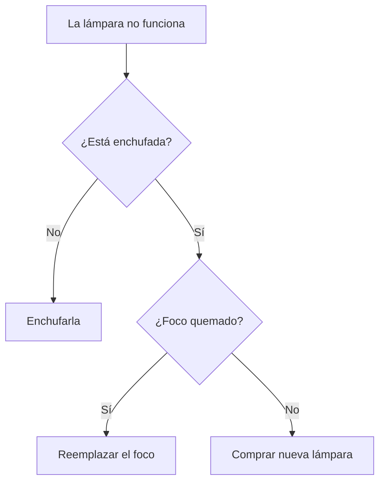

# Fundamentos de Programacion
* Conceptos Basicos
- Computador:
*  Un computador es un dispositivo electronico, utilizado para procesar datos y obtener resultados, capaz de ejecutar
  calculos y tomar desiciones, mucho mas rapido que un ser humano.
- Programa:
* Un programa informatico o programa de computadora es una secuencia de instrucciones, escritas para realizar
una tarea especifica en una computadora, en otras palabras para resolver problemas y para llegar a la resolucion de esos
problemas se necesita llegar a un algoritmo.
- Algoritmo:
* Un algoritmo es una lista bien definida, ordenada y finita de operaciones que permite llegar a la solucion de un problema.
* Dado un estado inicial y una entrada, a travez de pasos sucesivos y bien definidos se llega a un estado final, obteniendo una solucion.

* Pero para escribir ese algoritmo necesitamos tener un lenguaje de programacion para que nos ayude a comunicarnos con la maquina.
- Lenguaje de Programacion:
* Lenguaje formal diseñado para realizar procesos que pueden ser ejecutados por las computadoras.
* Pero el computador comprende solo de 0 y 1, entonces...
## ¿Como nos comunicamos?
- se hace a travez de traductor, interpretadores o compiladores.
- Compiladores:
* Lee el codigo fuente creado en un determinado lenguaje de programacion, lo interpreta comprueba su sintaxis y traduce a lenguaje de maquina toda la serie de instrucciones, generando un archivo ejecutable ( un programa compilado)

- Interpretadores:
* Es un programa (Ejemplo, Pycharm) que traduce un lenguaje de alto nivel al lenguaje de maquina de una computadora.
* El programa siempre permanece en su forma original (Programa Fuente) y traduce cuando es en la fase de ejecucion instruccion por instruccion.

## ¿Que es programacion?
* Es la ciencia que se encarga de indicarle al computador que hacer mediante pasos secuenciales y logicos. Estos pasos se llaman algoritmos los cuales se escriben
* en varios de lenguajes de programacion. 
